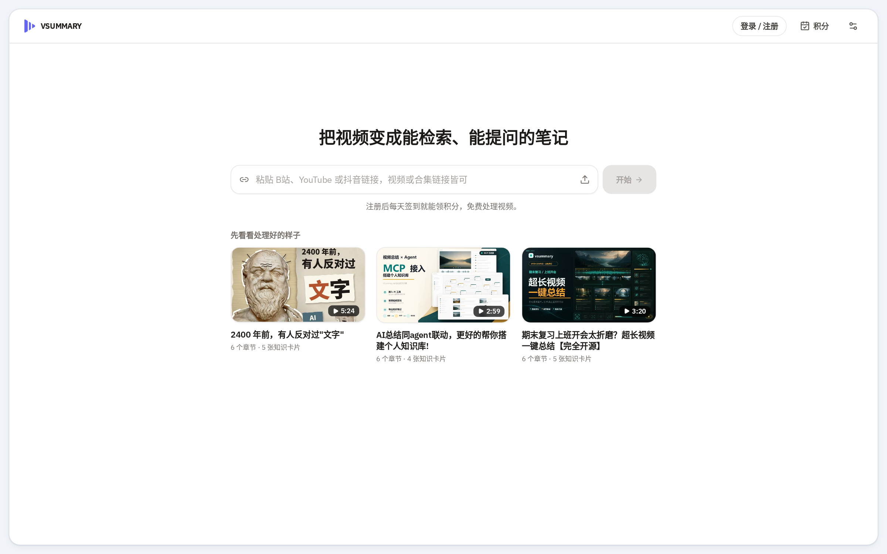
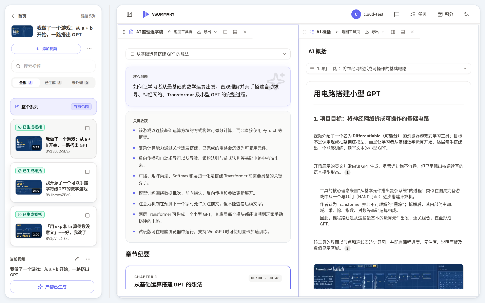
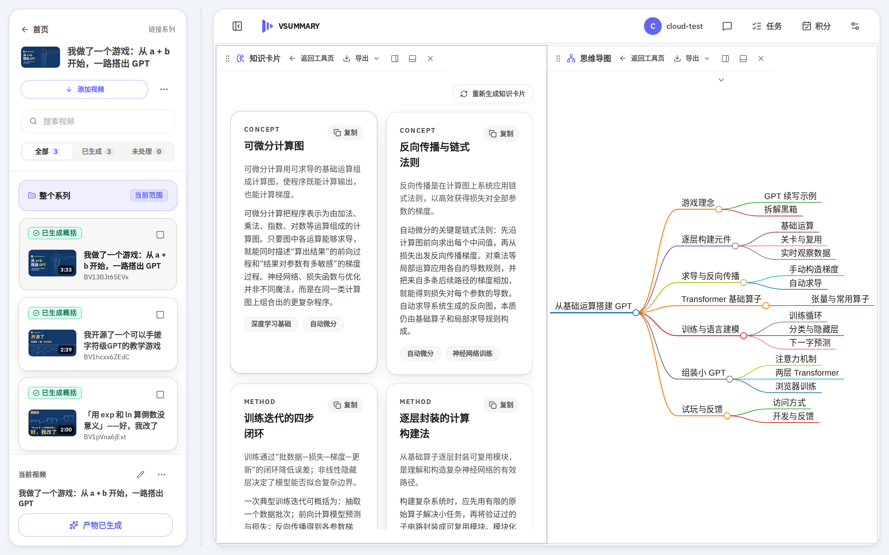
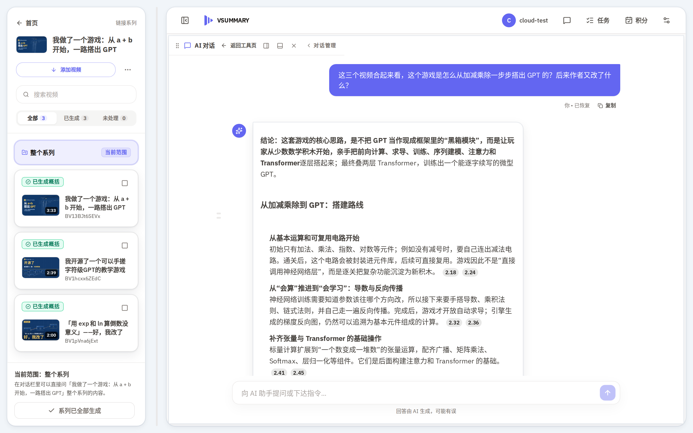
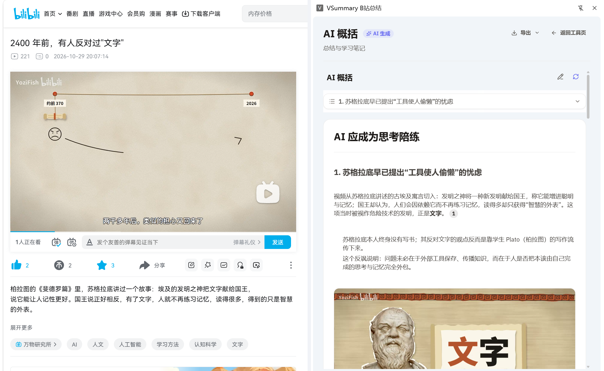
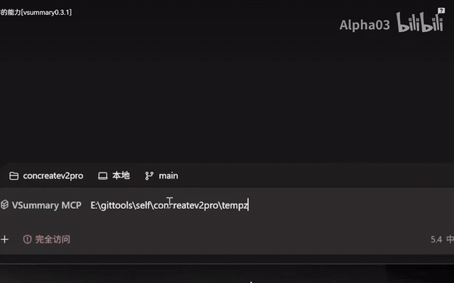
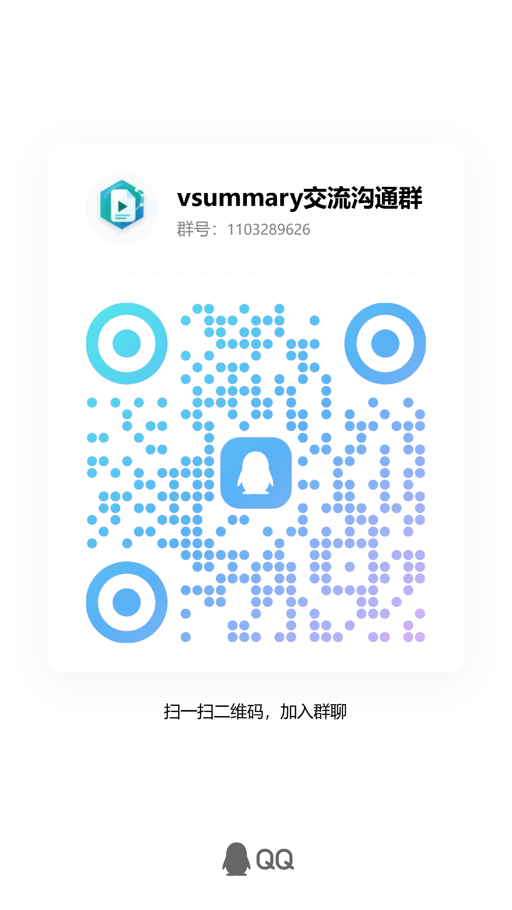

<div align="center">


# vsummary

视频AI总结，对话的本地知识库工具


### [VSummary在线版](https://vsummary.net)

**不想自己部署？** 打开 [vsummary.net](https://vsummary.net) 就能用，无需手动安装环境，还有每天免费额度可以领取<br />


<a href="https://vsummary.net"></a>

<a href="https://vsummary.net"></a>

</div>


---

## 功能展示

### 视频工作区

一个视频处理完，会得到章节纪要和 AI 概括。其中编号对应原视频里的出处。



### 思维导图和知识卡片

同一个视频还能生成思维导图和知识卡片，面板可以左右或上下拆分。可以自由拆分多面板使用



### 系列问答

把几个视频放进一个系列，就能一起提问。回答会综合每个视频的内容，编号能够跳转原文位置



### 浏览器插件

在 B站 看视频时，侧边栏里直接显示视频的 AI 概括、章节、思维导图和知识卡片。安装方法见[浏览器插件教程](docs/browser-extension.md)。



<details>
<summary><b>MCP：让 AI 助手整理本地录音</b></summary>

<br />

接入 MCP 后，AI 助手可以创建系列、导入本地媒体、发起处理并导出 Markdown。下面是把两段录音整理成一份结构化总结的过程。



</details>

## 核心特性

- **把视频变成可检索的知识库**：导入本地视频后，自动整理出转写文本、概况、章节和关键结论。后续可以直接围绕内容提问，把视频作为自己的本地知识库。支持导出为MD。
- **按系列管理学习资料**：适合课程、讲座、播客、会议录像等成组视频。你可以在一个系列里批量处理视频，并从系列视角理解整体内容。
- **单个视频深度阅读**：每个视频都有独立工作区，可以查看原视频、AI 概况、章节摘要、思维导图、知识卡片和笔记，适合精读一段长视频。
- **章节与转写一键跳转**：在 AI 概况中，**点击章节卡**或展开后的**任意转写段**即可直接跳到视频对应时间并自动播放，导航视频内容更直观。
- **围绕视频内容对话**：可以在单视频或整个系列范围内提问，让系统基于已经整理好的转写、摘要、笔记和知识卡片回答。
- **外部课程导入**：支持 Bilibili、抖音、YouTube 外链导入（抖音目前只支持单个视频，不支持合集）
- **MCP 自动化工作流**：通过 MCP 工具让 AI 助手创建和管理视频系列，导入本地媒体或 Bilibili 链接，跟踪处理进度，并导出 Markdown。
- **本地优先**：原始视频、转写结果、摘要、笔记和知识索引都保存在本地目录中；除了调用你配置的模型供应商外，不需要把视频上传到第三方平台。
- **低门槛启动**：提供 CPU / GPU 两种整合包，普通用户下载整合包解压后运行 `start.bat` 即可使用

---

## 快速开始

- [安装、硬件与 ASR 配置](docs/installation.md)：Windows NVIDIA、Windows AMD、macOS 的环境、模型与启动方式。

### 源码版 MySQL

Windows 整合包自带 MySQL，不需要安装 Windows 服务。源码版的 `start.bat` 会依次从 `VSUMMARY_MYSQL_HOME`、系统 `PATH`、`%ProgramFiles%\MySQL` 自动寻找 MySQL；找到后由应用在本机回环地址启动私有实例并管理迁移，不使用系统 MySQL 服务。

macOS / Apple Silicon 可按[安装说明](docs/installation.md#macos--apple-silicon)从源码运行，使用 whisper.cpp / Metal 转写；通过 `start.command` 启动本地网页和专用 MySQL。

### 抖音解析

抖音链接默认用 [F2](https://github.com/Johnserf-Seed/f2) 解析和下载（yt-dlp 访问抖音经常被拒绝）。整合包已自带 F2；源码版装完依赖后还要单独装一次 F2：

```bat
python -m pip install --no-deps -r requirements.nodeps.txt
```

不想装 F2 时，可以在 `config/settings.toml` 里改回 yt-dlp：

```toml
[external_import.douyin]
source = "ytdlp"   # 默认 "f2"
```

两种方式都需要先在导入界面点「获取 Cookie」登录抖音。

## 浏览器插件

VSummary 提供 Chrome 浏览器插件。观看 Bilibili 视频时，可以直接在浏览器侧边栏中查看 AI 概况、章节、思维导图、知识卡片和笔记，并围绕当前视频提问。

Windows 整合包解压后，插件位于 `extensions/bilibili-sidepanel`。启动 VSummary 后，在 Chrome 的扩展程序页面选择“加载已解压的扩展程序”，然后选择这个文件夹即可。

- [浏览器插件安装与使用教程](docs/browser-extension.md)

## 数据目录

- `%LOCALAPPDATA%\VSummary\blobs/`：当前版本的视频和二进制制品；设置 `VSUMMARY_DATA` 时使用指定的数据根目录
- `videos/`、`workspace/`：旧版本的原始视频和工作产物；旧目录导入由“设置 → 应用更新 → 旧版数据迁移”启动
- `data/models/`：本地模型文件


## 常见问题

常见问题见 [docs/questions.md](docs/questions.md)。
## 沟通和联系
- QQ群:点击链接加入群聊【vsummary交流沟通群】：https://qm.qq.com/q/nxKBApDVF


