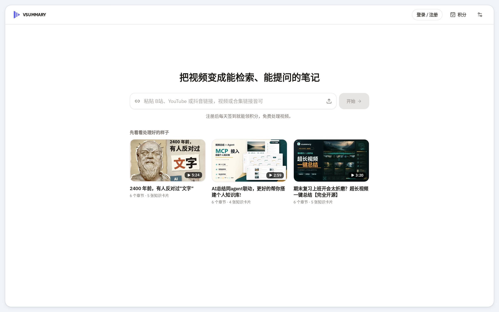
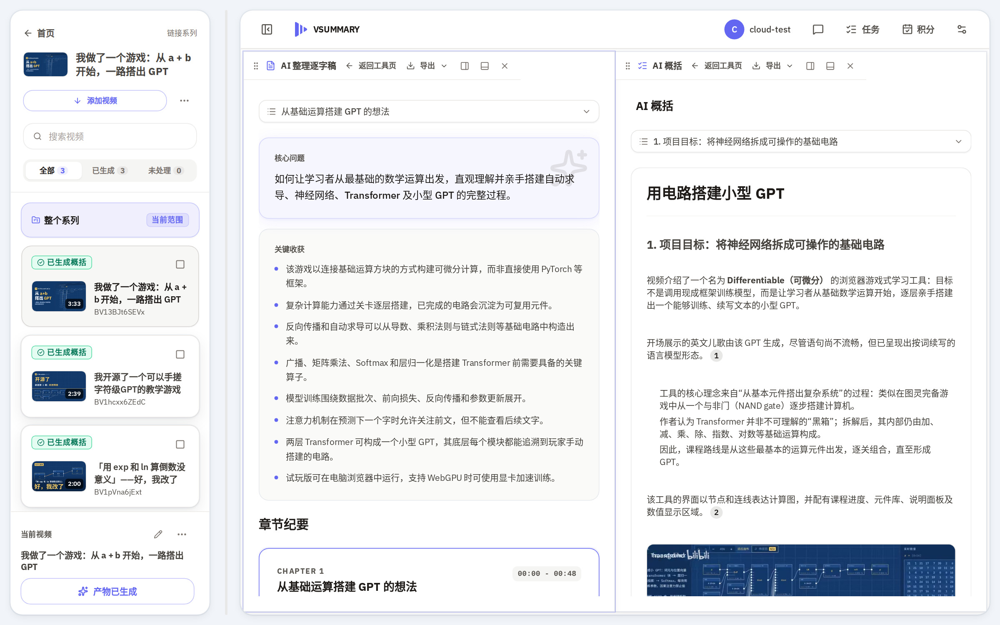
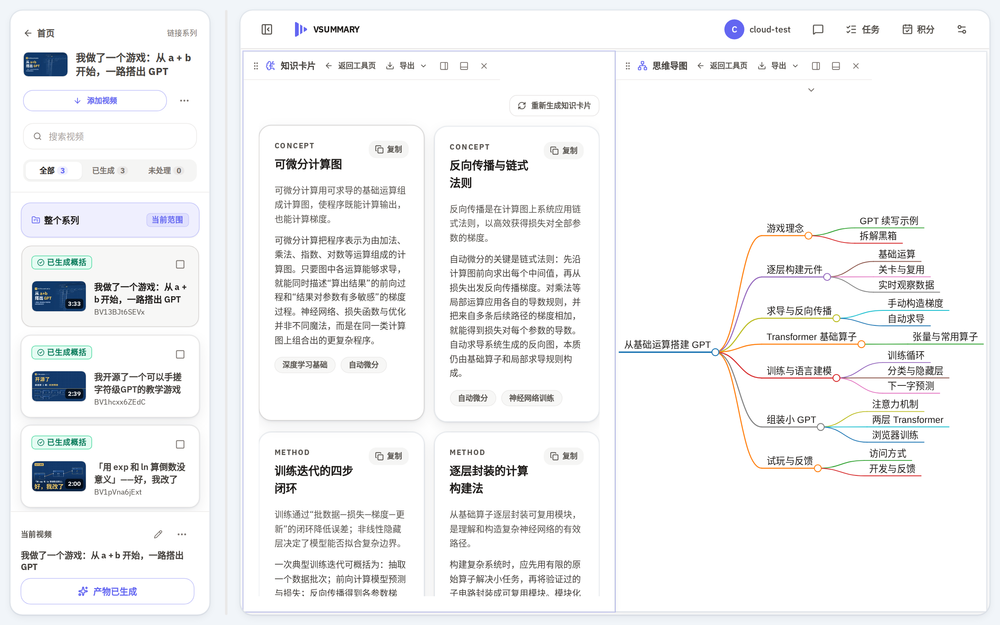
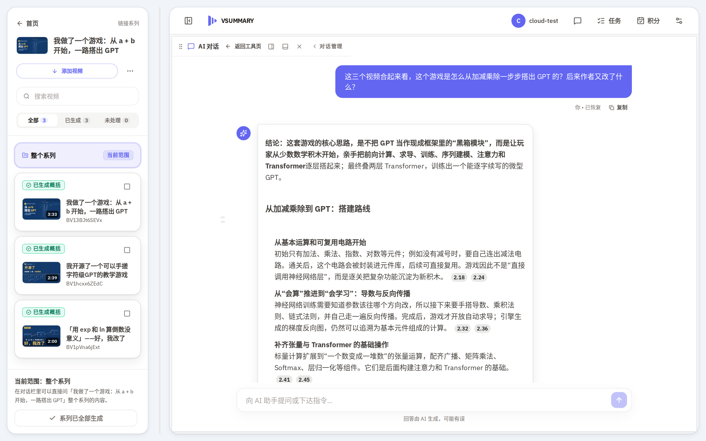
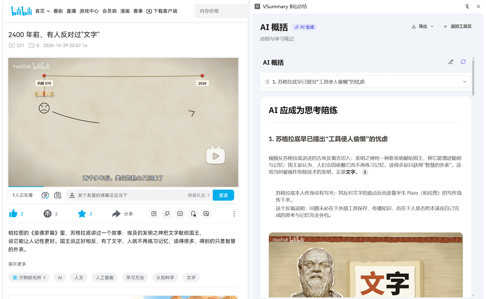
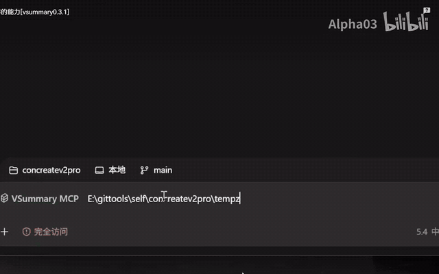

<div align="center">


# vsummary

Turn long videos into chapter notes you can search and ask questions about, on your own machine.

[中文](README.md) | **English**

[](https://github.com/alpha03123/vsummary/releases)
[](https://github.com/alpha03123/vsummary/releases)
[](https://github.com/alpha03123/vsummary/stargazers)


### [Hosted version: vsummary.net](https://vsummary.net)

Don't want to install anything? [vsummary.net](https://vsummary.net) runs the same tool in the browser, with a free daily quota. The hosted UI is in Chinese and it is still an early build.

If vsummary saves you some time, a ⭐ **Star** helps a lot. The project is maintained by one person.

<a href="https://vsummary.net"></a>

</div>

> The app UI and the detailed docs under `docs/` are currently in Chinese. This page covers what the tool does and how to get it running.

---

## What it looks like

### Video workspace

Each processed video gets chapter notes and an AI overview. The numbered citations point back to the exact spot in the original video.



### Mind maps and knowledge cards

The same video can also produce a mind map and a set of knowledge cards. Panels can be split side by side or stacked.



### Ask questions across a series

Put several videos into one series and ask questions about all of them at once. Answers draw on every video in the series, and the citations jump to the source passage.



### Browser extension

While watching a video on Bilibili, a Chrome side panel shows its AI overview, chapters, mind map and knowledge cards. See the [extension guide](docs/browser-extension.md) (Chinese).



<details>
<summary><b>MCP: let an AI assistant process local recordings</b></summary>

<br />

With the MCP server connected, an AI assistant can create series, import local media, start processing and export Markdown. Below, two recordings are turned into one structured summary.



</details>

## Features

- **Videos become a searchable knowledge base.** Imported videos are transcribed and organized into an overview, chapters and key takeaways. You can then ask questions about the content and export everything as Markdown.
- **Series for courses and lectures.** Group related videos (courses, talks, podcasts, meeting recordings), process them in batch and look at the material as a whole.
- **Deep reading of a single video.** Every video has its own workspace with the player, AI overview, chapter summaries, mind map, knowledge cards and notes.
- **Jump straight to the source.** Click a chapter card or any transcript segment and the video seeks to that moment and starts playing.
- **Chat with your videos.** Ask about one video or a whole series; answers are grounded in the transcripts, summaries, notes and cards already generated.
- **Import from links.** Bilibili (including collections), YouTube and Douyin links are supported. Douyin currently supports single videos only, not collections.
- **MCP workflow.** AI assistants can create and manage series, import local media or Bilibili links, track progress and export Markdown through MCP tools.
- **Local first.** Videos, transcripts, summaries, notes and the search index stay in local folders. Nothing is uploaded anywhere except the requests sent to the model provider you configure (bring your own API key; OpenAI-compatible APIs and Ollama are supported).
- **Easy start on Windows.** CPU and GPU bundles are available: unzip and run `start.bat`.

---

## Quick start

### Windows bundle (easiest)

Download the CPU or GPU bundle from the [latest release](https://github.com/alpha03123/vsummary/releases/latest), unzip it and run `start.bat`. MySQL, the browser extension and the Douyin parser are included. Then open the web UI and configure your model provider in the settings page.

### From source

All three setups create a Conda environment named `vsummary`. Pick the one that matches your machine. Full details, including model downloads and configuration, are in [docs/installation.md](docs/installation.md) (Chinese).

**Windows + NVIDIA GPU**

```powershell
git clone https://github.com/alpha03123/vsummary.git
cd vsummary
conda env create -f environment.yml
conda activate vsummary
python -m pip install --no-deps -r requirements.nodeps.txt
cd src/frontend
npm install
cd ../..
start.bat
```

**Windows + AMD GPU**: use `environment.cpu.yml` instead of `environment.yml`, and build a Vulkan `whisper-cli` from [whisper.cpp](https://github.com/ggml-org/whisper.cpp) for GPU transcription.

**macOS / Apple Silicon** (transcription via whisper.cpp with Metal; Intel Macs are untested):

```bash
brew install mysql@8.4 whisper-cpp ffmpeg node@22
git clone https://github.com/alpha03123/vsummary.git
cd vsummary
conda env create -f environment.cpu.yml
conda activate vsummary
python -m pip install --no-deps -r requirements.nodeps.txt
cd src/frontend && npm ci && npm run build && cd ../..
./start.command
```

`start.command` starts a private MySQL instance, runs migrations and opens `http://127.0.0.1:4173`.

### MySQL for source installs

The source version needs a MySQL 8.4 runtime, but not a system service. `start.bat` looks for it in `VSUMMARY_MYSQL_HOME`, then `PATH`, then `%ProgramFiles%\MySQL`, and runs its own private instance on the loopback address. If auto-detection fails:

```bat
setx VSUMMARY_MYSQL_HOME "D:\tools\mysql-8.4.9-winx64"
```

### Douyin links

Douyin links are parsed with [F2](https://github.com/Johnserf-Seed/f2) by default, because yt-dlp is often blocked there. The Windows bundle ships with F2; source installs get it from `requirements.nodeps.txt` (the `pip install --no-deps` step above). To switch back to yt-dlp, edit `config/settings.toml`:

```toml
[external_import.douyin]
source = "ytdlp"   # default: "f2"
```

Either way, click "Get Cookie" in the import dialog and log in to Douyin first.

## Browser extension

In the Windows bundle the extension is in `extensions/bilibili-sidepanel`. Start vsummary, open `chrome://extensions`, enable developer mode, choose "Load unpacked" and select that folder. See the [extension guide](docs/browser-extension.md) (Chinese).

## Data locations

- `%LOCALAPPDATA%\VSummary\blobs/`: videos and binary artifacts for the current version. Set `VSUMMARY_DATA` to use a different data root.
- `videos/`, `workspace/`: raw videos and outputs from older versions. Import them via Settings → App updates → Legacy data migration.
- `data/models/`: local model files.

## FAQ

See [docs/questions.md](docs/questions.md) (Chinese).

## Star history

<a href="https://star-history.com/#alpha03123/vsummary&Date">
  
</a>

## Community

Questions and feedback are welcome in [GitHub Issues](https://github.com/alpha03123/vsummary/issues). There is also a Chinese-language QQ group: https://qm.qq.com/q/nxKBApDVF

## Acknowledgements

- [Linux Do](https://linux.do)
- [@maolilup](https://github.com/maolilup) (mind maps and export) and [@imexlovery](https://github.com/imexlovery) (macOS build, local model downloads) for their code contributions
